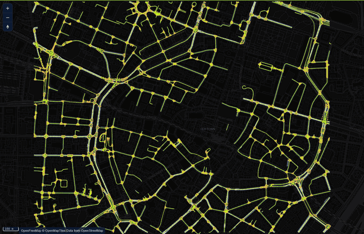
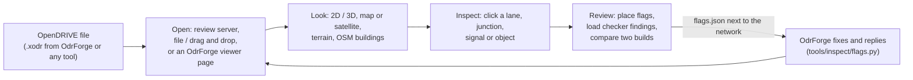
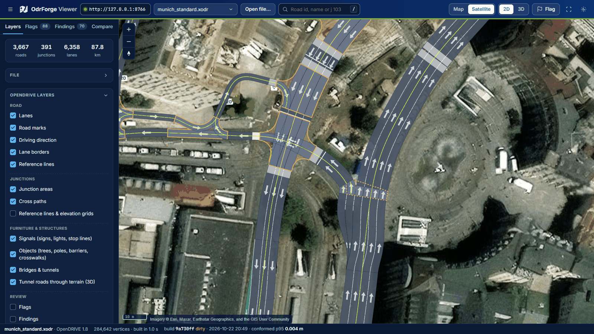
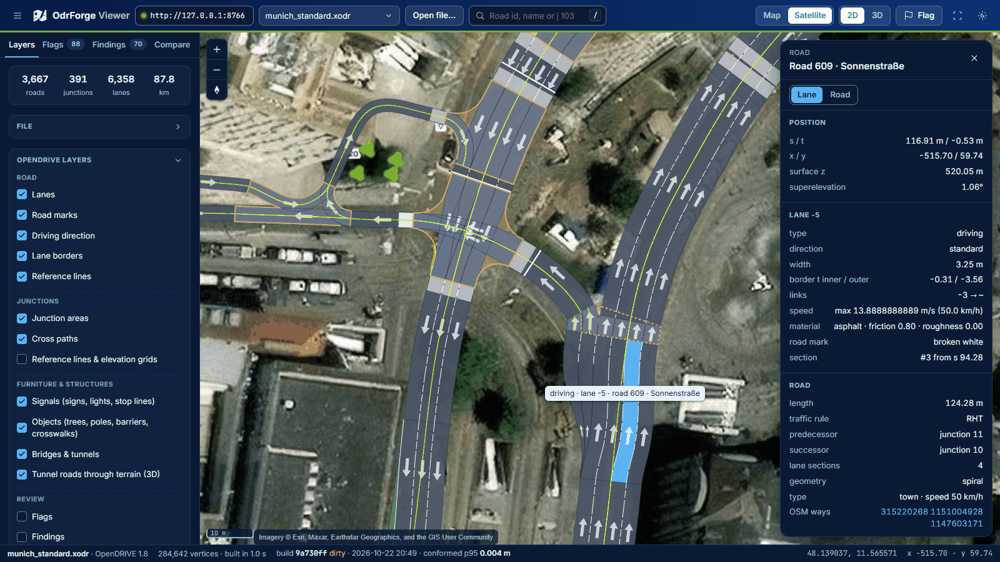
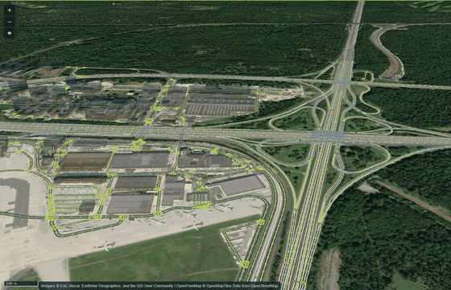
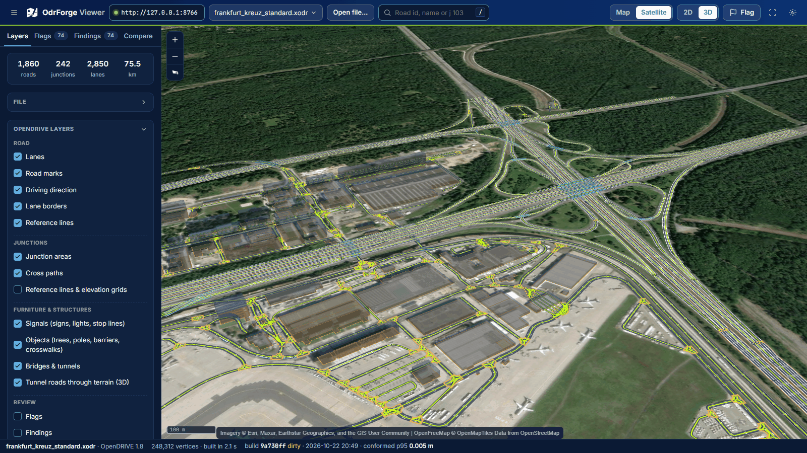
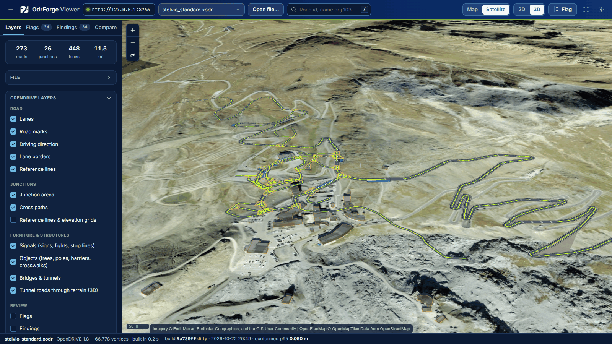
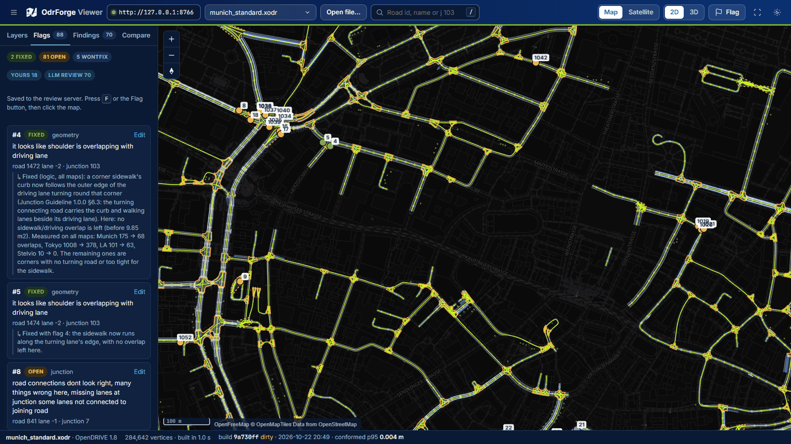
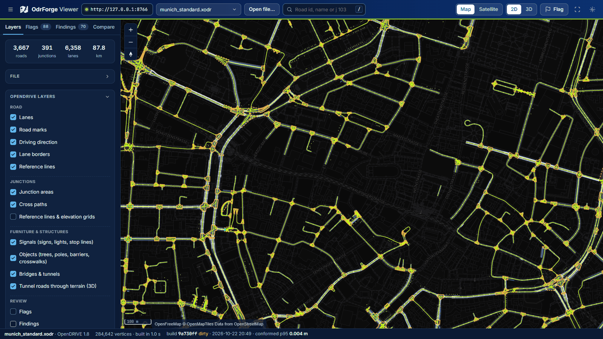

# OdrForge Viewer

Review tool for ASAM OpenDRIVE networks: 2D and 3D views of any `.xodr` on a MapLibre vector-tile map with OSM 3D
buildings and terrain, a lane / road inspector, review flags shared with the OdrForge review server, and checker
findings (ASAM Quality Checker, OdrForge exact invariants) as map markers.

Companion to [OdrForge](https://github.com/sagar-g-v/odrforge) (OSM → OpenDRIVE), but reads OpenDRIVE files from any
tool (OpenDRIVE 1.4 – 1.8).



*Munich city centre (OdrForge `--target standard`, 3,667 roads, 391 junctions, 6,358 lanes, 87.8 km): from the whole
network down to single lanes, road marks and driving directions.*

## Workflow



1. **Open** a network: from OdrForge's review server (flags are saved next to the `.xodr`), a local file, or an
   OdrForge `--viz` page.
2. **Look** at it in 2D or tilted 3D, over the OpenStreetMap map or satellite imagery, with terrain and buildings.
3. **Inspect** any lane: its OpenDRIVE records at the clicked point (s / t, width, height, superelevation, speed,
   material, links) and the OSM ways it came from.
4. **Review**: mark what is wrong with a flag, load ASAM Quality Checker / OdrForge findings, or compare two builds of
   the same area. The converter answers each flag in the same file, and the reply shows in the list.

## In pictures

All screenshots are of this viewer (dev server, headless Chrome, 1600 × 900) on OdrForge outputs of the test areas,
loaded from the review server. Map data © OpenStreetMap contributors; imagery © Esri, Maxar, Earthstar Geographics.

**A junction over satellite imagery.** Lanes, junction area (orange outline), stop lines, crosswalks and driving
arrows drawn at the file's geometry over Esri World Imagery, Munich (Sonnenstraße / Karlsplatz).



**Lane inspector.** Clicking lane −5 of road 609 (Sonnenstraße) shows the lane's records at that point: s / t,
surface height, superelevation, width, links, speed, material and road mark, the road's links and geometry, and the
OSM ways it was built from (linked).



**3D.** The Frankfurter Kreuz (A3 over A5) in tilted 3D over satellite imagery: the camera circles the
interchange; bridges and ramps are drawn at the heights the file gives them.



| | |
|---|---|
|  |  |
| Frankfurter Kreuz, 3D over satellite imagery (1,860 roads, 242 junctions) | Stelvio Pass: the hairpins on the mountain terrain (273 roads, 11.5 km) |

**Review flags.** The Flags tab lists every flag with its status (fixed / open / won't fix), the note it was placed
with and the converter's reply; the numbered markers on the map are the same flags.



**The whole network.** Munich city centre in 2D over the OpenStreetMap map: lanes, junction areas and signals for all
3,667 roads.



## Run

```bash
npm install
npm run dev          # http://localhost:5173
```

Production build: `npm run build`, then `npm run preview` (or serve `dist/` statically).

Open a network in one of three ways:

- **Review server** (flags are saved next to the network): start OdrForge's server on the folder with the `.xodr`
  files, enter its URL in the top bar and pick a file.
  ```bash
  python tools/inspect/viz_server.py --dir path/to/outputs --port 8766
  ```
  Deep link: `http://localhost:5173/?server=http://127.0.0.1:8766&file=munich_standard.xodr`
- **Open file…** or drag and drop a `.xodr` (flags then stay in this browser; export them as JSON).
- An OdrForge viewer page (`.html` from `odrforge view <in.xodr> <out.html>` or `odrforge build ... --viz`): its embedded, pre-sampled data loads faster.

## Using it

| | |
|---|---|
| **Map / Satellite** | top bar: the standard OpenStreetMap map (default) or live satellite (Esri World Imagery); more styles and the offline HD orthophoto under Layers |
| **CARTO basemaps** | CARTO Voyager as a vector style or raster tiles (Base map group), when the environment variable `CARTO_MAP_API` holds a CARTO key at dev / build time (Vite exposes only that variable; the key ends up in tile requests and in a production bundle, as for any browser map key). Without it the options show as unavailable |
| **2D / 3D** (`V`) | top-down review or tilted 3D with OSM buildings (opacity slider keeps roads behind them visible) |
| **Accuracy** | what the viewer shows must be reproducible in CARLA / Blender: the rules, the tests that guard each one and the real-data limits are in [docs/ACCURACY.md](docs/ACCURACY.md); `odrvAudit()` in the browser console (dev) measures drawn roads against drawn terrain |
| **Road heights** | *flat* (ignore z), *relative* (median road height on the ground), *absolute* (file heights above sea level). Every surface is drawn at the file's height: nothing is lifted or lowered for display; surfaces lying on each other (terrain, junction area, lanes, marks, outlines) are ordered by depth bias only. A file with real heights keeps them in relative mode too. With **Terrain**, a file without absolute heights is laid on the ground in flat / relative mode (bridges and tunnels keep their height difference). Signals and objects are symbols at the file's position and size (a typical size where the file gives none, said in the inspector) |
| **Terrain** | the network's own ground grid where the review server has one (the converter's road-conformed `<area>_ground_conformed.odrz` first, then `<area>_ground.odrz`), rendered as MapLibre terrain tiles on the fly and blended into Mapzen Terrarium over 30 m at its edge; Terrarium alone elsewhere. **The road wins:** where the ground would rise through a road, it is pressed 5 cm under every lane and every junction surface the file defines, with a steep cut around them (`src/map/roadFloor.ts`; tunnels are left alone). The roads keep the file's heights exactly; the converter bakes the same floor into its published grid, so CARLA and Blender show the same ground. Measured: no lane point under the drawn ground in any test area ([docs/ACCURACY.md](docs/ACCURACY.md) §2, §4) |
| **Junction areas** | the file's `<boundary>` (OpenDRIVE 1.8 §12.10: lane segments along a lane's outer border, joints across the arm ends) solid, at the heights of the junction's `<elevationGrid>` (§12.11) where it has one; a virtual junction's main-road span (§12.5); files without either get an approximate dashed outline (hull of the connecting roads). Click one, or search `j 103` |
| **Junction grids** | the junction reference line (OpenDRIVE 1.8 §12.9, dashed red) and the `<elevationGrid>` (§12.11): every grid point at its z-value (row k at sStart + k · gridSpacing, left / right points every gridSpacing along the perpendicular), lines between neighbouring points; rows past the line's end continue it straight. Between the points the grid is interpolated bicubically (§12.11.1, `src/xodr/elevationGrid.ts`) for the junction's fill |
| **Road furniture** | signals as boards on posts (value labels), traffic lights with red / amber / green lamps, stop and waiting lines across their lanes; trees, poles, street lamps, guard rails stretched by `<repeat>`, sized boxes / cylinders; bridges and tunnels over their s range; junction cross paths. Click any of them for every attribute (validity, dependencies, references, semantics, controllers) |
| **Object outlines** | every `<outline>` of an object (1.8.0 §13.3, and the 1.4 form without `<outlines>`): areas flat on the road, areas with height as solid blocks up to their highest corner, `closed="false"` outlines as lines; `<cornerLocal>` about the object's insertion point, `<cornerRoad>` at its s / t with z = reference line elevation + dz |
| **Lane layers** (OpenDRIVE 1.9) | a road's temporary lane layer (§11.2, roadworks: its own lane offset and lane sections, which may end at their `@length`, §11.4) drawn over the permanent lanes as a yellow −45° hatch with its own driving arrows and road marks (the file's colours, yellow by the spec); the permanent layout shows between the stripes. Toggle under Layers → Road; click a temporary lane for its inspector. Permanent lanes with `@roadworks="true"` say so in the inspector |
| **Road marks** | every line of every `<roadMark>`: double lines in spec order (1.9.0 Annex A: inside to outside, centre lane left to right), explicit `<type><line>` patterns, all colours |
| **Inspector** | click a lane: s / t, width, border offsets, surface z, superelevation, lane links, and the lane records in force at that point (height, material, speed, access, rule), road marks, road type, every `<userData>` entry (OSM source ways linked); click a junction area, its reference line or grid: boundary, reference line (§12.9), elevation grid (§12.11: spacing, rows, z range), connections, rules |
| **Flags** (`F`) | click where something is wrong, pick a category, describe it; replies from `flags.py` show in the list |
| **Findings** | load `.xqar` (ASAM qc-opendrive) and `invariants.json` (OdrForge); grouped by rule, toggle per rule, click to fly |
| **Compare** | open a second build of the same area (B) from the review server or a file: B's lane outlines and reference lines in magenta over A; a list of roads and junctions only in A / only in B, and per road matched by id the changes in length, reference line position and height (nearest-segment distance, WGS84 metres; reported above 5 cm / 5 cm / 1 cm), lane layout per section, links, junction membership, signal / object counts; click to fly there |
| **Search** (`/`) | road id or name |
| **File** | the `<header>`: name, OpenDRIVE version, file version, vendor, date, extent, offset, georeference, license, user data; junction groups (§12.13, e.g. roundabouts) in the file and the junction inspector |
| **Problems in a file** | a file that is not OpenDRIVE or not well-formed XML (a truncated download, a mismatched tag) is refused with the line; what a readable file gets wrong (values that are not numbers, roads that cannot be drawn, an unusable geoReference) is listed in a banner and the rest is drawn. A display error stops at the map (the side panel stays usable) with *Try again* / *Open another file* |

## How it works

- `src/xodr/` reads OpenDRIVE without the DOM (a small XML reader), evaluates the reference line (line, arc,
  spiral, poly3, paramPoly3; ASAM OpenDRIVE 1.8.0 §9), lane borders (lane offset, width / border records; §11),
  lane heights (§11.10) and the road surface (elevation, superelevation; §10.5), and samples every lane into
  polygons: at every element / record boundary, at most 2 m apart, closer on curves (chord error ≤ 1 cm).
- Positions are projected to WGS84 with the file's `<geoReference>` (proj4) in a Web Worker and drawn by deck.gl
  binary layers interleaved into MapLibre GL, so buildings and roads share one depth buffer.
- MapLibre GL 6 with deck.gl 9.4: deck.gl's interleaved overlay still reads `map.transform`, which MapLibre 6 no
  longer exposes; `src/map/MapView.tsx` supplies the four values it needs from public API (remove when deck.gl
  supports MapLibre 6). MapLibre 5 is avoided: it carries GHSA-jrc7-96c5-q579.
- HD satellite: the network's offline orthophoto made by OdrForge's `tools/make_basemap.py` (official 0.2 – 0.6 m
  imagery, e.g. Bavaria DOP40, Hessen DOP20, USGS NAIP), found next to the network on the review server and drawn as
  georeferenced tiles at the zoom-appropriate pyramid level; Esri World Imagery (online) everywhere else.
- Basemaps: [OpenFreeMap](https://openfreemap.org) vector tiles (OpenMapTiles schema, © OpenStreetMap
  contributors); terrain: Mapzen Terrarium tiles (AWS Open Data). No API keys.

Accuracy (tests/xodr.test.ts, Stelvio): every geometry element ends where the file starts the next one within 1 mm;
lane borders agree with OdrForge's reference sampler (tools/inspect/odrgeom.py) within 5 mm, p99 1.4 mm — the
largest difference is odrgeom's own (4.6 mm off the file's exact start point). Load time for the 35 MB Los Angeles
network (698 k vertices): 1.3 s in Node, 1.4 s in the production build.

## Develop

```bash
npm test             # vitest: geometry, lanes, parsers, flags, broken files, real-data limits (skipped without the test areas)
npx tsc -b           # types
npx oxlint src tests # lint
npm run build && npm run e2e  # UI smoke test on the production build (Playwright, your installed Chrome)
```

Test fixtures contain OdrForge output derived from OpenStreetMap data (© OpenStreetMap contributors, ODbL 1.0).
